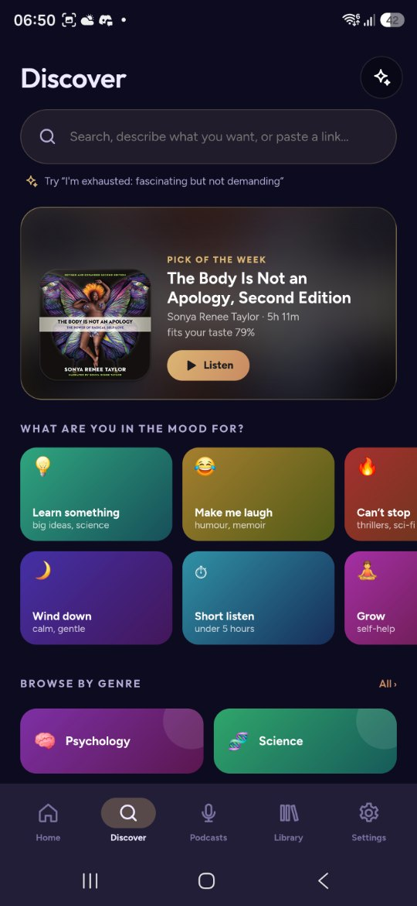
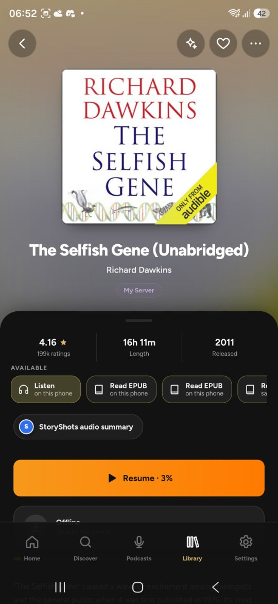
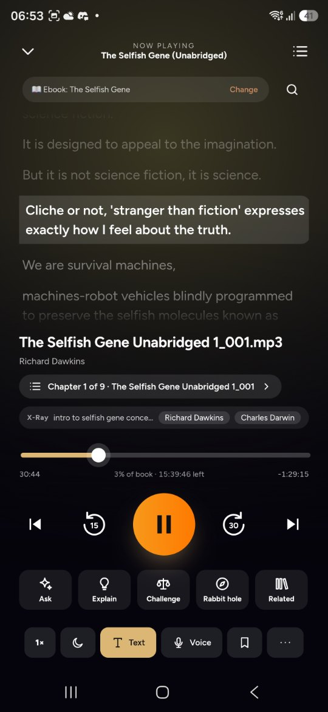
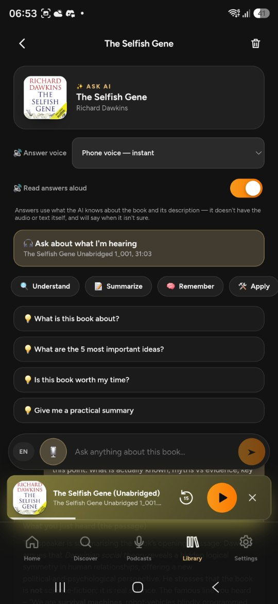
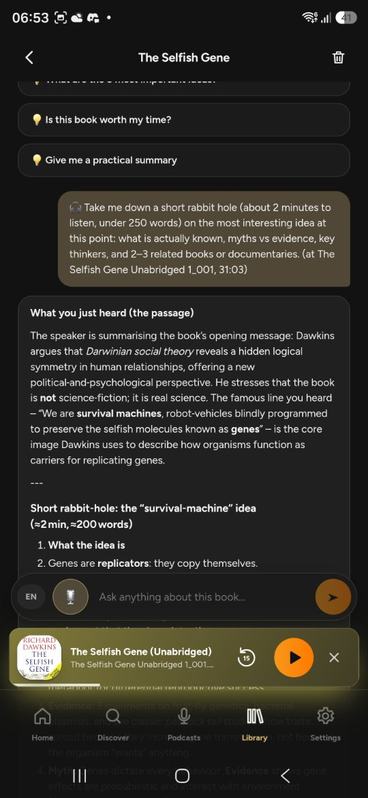
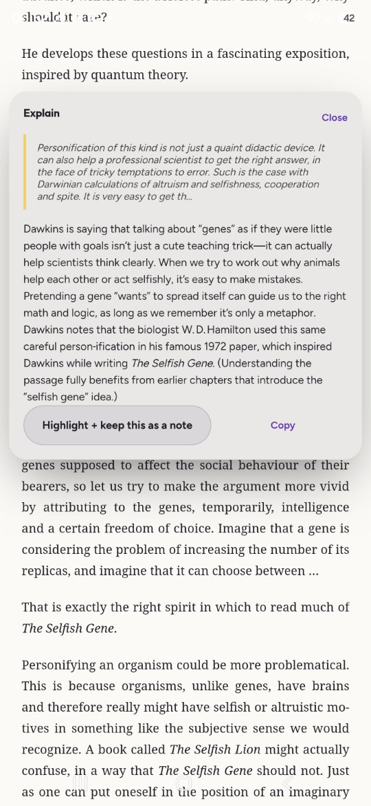
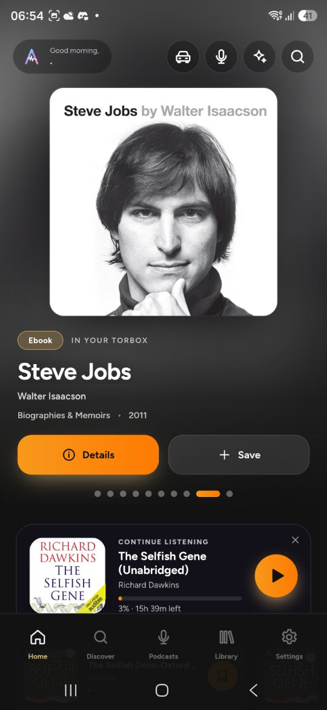
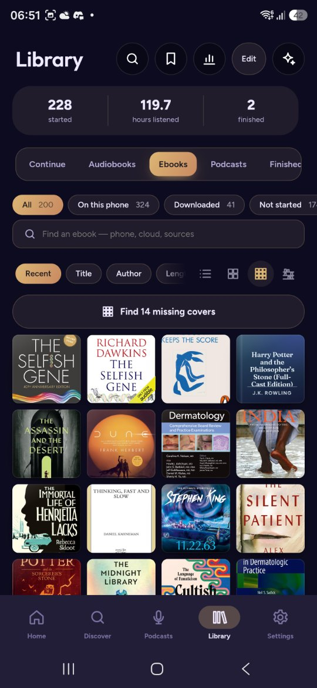
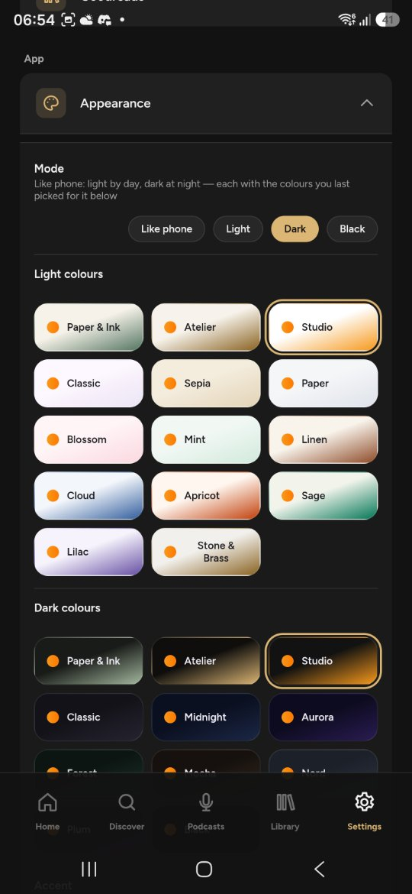

# Audiohub

**An audiobook, ebook and podcast app for Android (and the web) that plays from your own
Audiobookshelf server and your own cloud storage — with smart recommendations, ratings,
read-aloud voices and a polished player.**

Built with Preact + Vite, packaged for Android with Capacitor 8.

📖 **New here? Read the [FAQ](FAQ.md)** — setup for Audiobookshelf, Tailscale, qBittorrent, debrid, sync and the web relay, plus troubleshooting.

---

## Screenshots

<table>
<tr>
<td align="center" width="33%"><br><sub>Discover by mood, genre or just describe it</sub></td>
<td align="center" width="33%"><br><sub>Everything for a book in one place</sub></td>
<td align="center" width="33%"><br><sub>Read along: the ebook's exact words as you listen</sub></td>
</tr>
<tr>
<td align="center" width="33%"><br><sub>Ask AI about what you just heard</sub></td>
<td align="center" width="33%"><br><sub>Rabbit hole: dig into an idea</sub></td>
<td align="center" width="33%"><br><sub>Select any passage in the reader and get it explained</sub></td>
</tr>
<tr>
<td align="center" width="33%"><br><sub>Home</sub></td>
<td align="center" width="33%"><br><sub>Your library, with covers found for you</sub></td>
<td align="center" width="33%"><br><sub>Light and dark themes for every taste</sub></td>
</tr>
</table>

<sub>Screenshots from the latest version.</sub>

---

## Features

**Your library, wherever it lives**
- **Audiobookshelf** — sign in with a password or API key, browse and stream your library, progress syncs both ways. Add a second address (e.g. Tailscale) and the app switches automatically — even mid-book, continuing from the same second.
- **TorBox / Real-Debrid** — browse and stream what's already in your cloud; links are fetched just before playback so they don't expire mid-book.
- **qBittorrent (home server)** — optionally forward new cloud audiobooks to your server, skipping books your Audiobookshelf already has; ebooks go to a separate folder.
- **Podcasts** — subscribe, search, OPML import/export, and a Podcasts tab in the library.
- **Hardcover** shelves and **Goodreads** export import.

**Discover**
- Genre pages with *For you*, *Bestsellers*, *Trending* and *Best of (year)* tabs, plus an "I have N hours" length filter.
- **Recommendations that learn your taste** — rate books (❤️ / 👍 / 😐 / 👎 / didn't finish, with story and narration scores); picks show a match % and a "why this pick" line, skip what you already have, and hold back poorly narrated titles.
- **AI bookseller** — ask in plain words ("atmospheric sci-fi under 12 hours like Project Hail Mary").
- **Paste a link** — an MP3 / M4B link plays (and can be kept in your Library), an EPUB / PDF link opens in the reader, an Internet Archive page or a podcast feed opens directly.
- **Key ideas** summaries on book pages (AI), and **Goodreads ratings** on every tile.

**Player**
- Background playback with lock-screen and earphone controls, chapters (also read from inside single-file M4B books), 0.5×–3× speed and volume boost kept per book, skip silence, sleep timer (fade-out, end of chapter, sleep detection).
- Bookmarks named after what was being said, with your own notes; on the book page and in Notes, exported as Markdown.
- **Live transcript** (on-device speech recognition) — with the book's ebook attached (found by itself), it shows the book's own words; search what you've heard and tap to jump.
- **X-Ray** — who and where is in the scene, and every chapter a character appears in. **Story** — spoiler-free recaps and characters; a "welcome back" recap after a break.
- Resumes from your latest place whichever copy you play (phone, download, server, cloud).
- Player backgrounds: cover, living gradient, bundled wallpapers or your own photo.

**Voice and AI (bring your own key)**
- One **voice button** (Home, player, home-screen widget): "back 30 seconds", "next chapter", "chapter 7", "speed 1.5", "sleep in 20 minutes", "bookmark", "play Sapiens", "find a book on consciousness", or any question about a book.
- **Driving mode** — huge controls, ask out loud and hear short answers, voice commands.
- **Ask AI** about a book or your whole library; in the player: Explain, Challenge, Rabbit hole, Related, Recall, Remember.
- Works with **Groq, Gemini, OpenRouter** (free keys), **Claude** (paid) or **your own** OpenAI-compatible AI (Ollama, LM Studio…). Only what an AI feature needs is sent, to the service you chose; playback and everything else work without AI.

**Library**
- List, grid, covers-only or shelves (by author / series); search your own books; smart shelves (Not started, Short listens, Recently added); series progress; one tap finds missing covers.
- Downloads by Author / Series folders, with a storage view and "remove finished".

**Ebooks**
- EPUB and PDF reader with themes, highlights and notes, Send to Kindle, and **read-aloud** with natural voices (Microsoft Edge neural voices, on-device Sherpa/Piper voices, or any installed TTS engine) that keeps going with the screen off.

**Podcasts**
- Rate episodes (👍 / 👎 / not interested), recommended episodes, new episodes downloaded on Wi-Fi per show.

**Looks**
- Light, dark and black, with many colour themes for each (each mode keeps its own), accents, dynamic colour from cover art.

**Backup and sync**
- Backup to a file (everything, with logins and API keys optional); optional cloud sync with your own Supabase.

**Optional: add-ons and trackers (at your own risk)**
- You can add **source add-ons** (your own search sources) and your own **tracker site** (the app opens it in a built-in browser and sends downloads you tap to your qBittorrent).
- Audiohub **ships with no sources or trackers**. What you add, and what you download through it, is your choice and your responsibility. Respect copyright, your tracker's rules, and the laws where you live.

---

## Install

Download the latest `Audiohub-v….apk` from **[Releases](../../releases)**, open it on your phone and allow "Install unknown apps" when asked.

The web version (for iPhone/iPad/desktop) is published on GitHub Pages by the *Web app* workflow.

---

## Build it yourself

```bash
npm ci
npm run build          # web app → dist/
npx cap sync android   # copy it into the Android project
cd android && ./gradlew assembleRelease
```

Or let GitHub Actions do it: every push to `main` runs **Android APK** (`.github/workflows/android.yml`), which builds a release APK and publishes it as a GitHub Release, and **Web app** (`.github/workflows/web.yml`), which publishes the web version on GitHub Pages (Settings → Pages → Source: *GitHub Actions*).

### Signing (so updates install over each other)

Without a key, each build is signed with a throwaway key and you'd have to uninstall before updating. Create your own once:

```bash
keytool -genkeypair -keystore audiohub.jks -alias inkwell -keyalg RSA -keysize 2048 -validity 10000 -storepass YOUR_PASSWORD -keypass YOUR_PASSWORD -dname "CN=Audiohub"
base64 -i audiohub.jks | tr -d '\n'   # copy the output
```

Then in your repository: **Settings → Secrets and variables → Actions** → add
- `AUDIOHUB_KEYSTORE_BASE64` — the base64 text
- `AUDIOHUB_KEYSTORE_PASSWORD` — your password

Never commit the `.jks` file.

### Optional: cloud sync (your own Supabase)

Account & sync (library, progress, settings across devices) uses a free [Supabase](https://supabase.com) project of your own. Put its URL and anon key in `.env.production`:

```
VITE_SUPABASE_URL=https://<your-project>.supabase.co
VITE_SUPABASE_ANON_KEY=<anon key>
```

Leave them empty to use Audiohub without sync.

### Optional: web relay (for the web version)

Browsers block some services (Audible listings, Goodreads, Hardcover…). The web version sends those through a tiny relay you host yourself — the same code (`relay/index.ts`) runs as a **Cloudflare Worker** (recommended; works in Safari/iPhone) or a **Supabase Edge Function**. Steps are in the app under *Settings → Web app*. The Android app doesn't need it.

---

## Notes

- Read-aloud "Edge" voices use Microsoft's online speech service unofficially; for personal use.
- Ratings come from Goodreads' public search suggestions; recommendations use Audible's public catalogue.
- Not affiliated with Audiobookshelf, Audible, Goodreads, TorBox, Real-Debrid or any tracker.

## License

[MIT](LICENSE)
